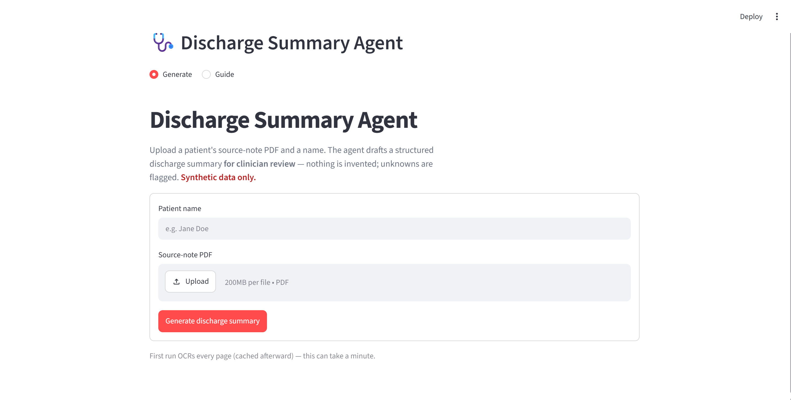

# Agentic AI for Discharge Summaries

An agentic system that reads a patient's messy, **image-only** source-note PDFs and
produces a **structured discharge-summary draft for clinician review** — under a hard
**no-fabrication** guarantee. Built from scratch (a real ReAct loop, not a fixed
pipeline) on the OpenAI API.

> **The one rule that matters most:** the agent never invents a clinical fact. Every
> field is either sourced with a verbatim citation that re-verifies against the page,
> or it is explicitly marked **MISSING / PENDING / CONFLICT** and flagged for review.
> The output is always a *draft*, never an auto-finalized document.

**Status:** Part 1 (the discharge-summary agent) is complete and runnable end-to-end,
delivered as a **Streamlit frontend** (upload a PDF → view and download the draft).
An optional FastAPI API remains available for integrations. Part 2 (learning from doctor edits) is **built and measured** — see
[Part 2](#part-2--learning-from-doctor-edits).

The Python engine lives in `backend/`, and the Streamlit entry point is
`frontend/streamlit_app.py`. The agent core is reused unchanged by the CLI, Streamlit app,
and optional API — nothing is hardcoded to a particular patient.

---

## Architecture

Full system — ingestion (render → OCR every page) → agent core (gpt-5-mini brain · AgentState ·
tool registry · no-fab guardrail) → outputs (`discharge_summary.md` + `trace.json`):


The agent's five-phase ReAct loop, with the **re-plan edge** (Validate → Extract) that makes it
an agent rather than a pipeline:


---

## Setup

**Prerequisites:** Python 3.12 and an `OPENAI_API_KEY`.

**Run the Streamlit app from the repository root:**

```bash
python -m venv .venv
.venv\Scripts\activate                 # Windows   (macOS/Linux: source .venv/bin/activate)
pip install -r requirements.txt
copy .env.example .env                 # Windows   (macOS/Linux: cp .env.example .env)
#  → open .env and paste your OPENAI_API_KEY
streamlit run frontend/streamlit_app.py
```

Open the displayed local URL, normally **http://localhost:8501**. Choose **Generate** or
**Guide**, upload a synthetic PDF, and download the Markdown draft or the ZIP containing the
draft, trace, and validated state.

> The first run OCRs every page (a few cents) and caches it; later runs reuse the cache.
>
### Optional FastAPI API

The Streamlit app does not require a separate API server. For API clients or integrations,
start the optional FastAPI service from the repository root:

```bash
python -m uvicorn backend.api.app:app --port 8000
```

> Run uvicorn from the repository root with `backend.api.app:app`; do not `cd backend` first.
> The API is not needed when using Streamlit.

### CLI (optional — same engine, no web app)

```bash
python -m backend.main run   patient_2                # -> outputs/patient_2/discharge_summary.md + trace.json
python -m backend.main add   notes.pdf --name "Jane Doe"   # upload a new patient PDF + run the full pipeline
python -m backend.main learn patient_2                # Part 2: learning curve + metrics
python -m unittest discover -s tests                  # run the test suite (38 tests)
```

Outputs land in `outputs/<patient_id>/`:
`discharge_summary.md` (the deliverable), `trace.json` (step-by-step log),
`agent_state.json` (the validated state), `ocr_dump.md` (human-readable OCR).

**LLMs (OpenAI only):** brain/planner `gpt-5-mini`; vision OCR `gpt-4.1-mini`.
(Free-tier Gemini was rejected because it retains/trains on inputs, which conflicts with
the task's data-handling rule; the paid OpenAI API does not train on data by default.)

---

## Ingestion — image-only PDFs

The provided data is **71 pages, every page a full-page scanned image with zero embedded
text layer** (typed notes *and* genuine handwriting). A normal PDF text extractor returns
nothing. So:

- `pdfplumber` is used **only to rasterize** each page to a PNG (downscaled to ≤2048 px).
- **Every page** goes through `gpt-4.1-mini` vision OCR — there is no typed-vs-handwritten
  routing, because the typed pages have no text layer either.
- OCR is **disk-cached** by `sha256(image)+model+prompt-version`, and a degenerate-repetition
  guard collapses runaway vision output (one ICU chart OCR'd to 73 k chars of a repeated
  token → collapsed to ~170 and flagged).
- A title-first classifier segments pages into doc types (admission / labs / meds / nursing
  / …). This is an **organizing aid only** — the agent always reads raw OCR text by page
  number, so a mis-label can never inject a wrong clinical fact.

See `discharge_agent_system_architecture.svg`. Ingestion detail: `docs/Phase1-Foundation-and-Ingestion.md`.

---

## The agent loop

A from-scratch **ReAct loop** (`backend/agent/loop.py`): each turn the `gpt-5-mini` brain sees a
document-type index + the current status of all 12 fields, and **decides the next tool
call(s)** via OpenAI function calling. Tool results are observed and fed back, so it
**re-plans from what it reads** — it is not a hardcoded pipeline. Five phases
(`discharge_agent_loop.svg`): ingest & plan → extract → conflict & gap → reconcile & draft →
validate & output, with a **re-plan edge** from Validate back into Extract.

- **The 12 required sections ARE the agent's state fields.** Each is a `FieldValue`
  `{value, status, citations[], notes}` (`backend/agent/state.py`).
- **Control:** a hard `MAX_STEPS=25` cap. On cap (or a premature `finish` while fields are
  unattempted) the loop finalizes gracefully — unresolved fields stay missing/pending.
- **Re-plan edge:** if the brain tries to `finish` while required fields are still MISSING,
  the loop nudges it to look in other document types before finishing (bounded by `MAX_REPLANS`).

### Tools (6) — the brain decides when to call each
| Tool | Purpose |
|---|---|
| `parse_doc` | fetch raw OCR text for specific pages (read/verify before deciding) |
| `extract_field` | propose one field **with verbatim citations** from given pages (committed via the guardrail) |
| `validate_set` | the guardrail write path — mark pending/missing or record a conflict |
| `reconcile` | deterministic admission-vs-discharge med diff (added/stopped/changed/continued + undocumented-reason flag) |
| `drug_interaction` | **mock** interaction lookup (brand→generic mapping; never assumes "none" = safe) |
| `flag_review` | escalate something uncertain/conflicting/risky for clinician review |

---

## The no-fabrication guardrail (the core)

Enforced **structurally**, in one place (`backend/tools/validate_set.py`), so the guarantee
holds regardless of what the LLM proposes:

1. A field becomes `present` **only if** it has a non-empty value **and at least one
   citation whose verbatim quote re-verifies against the cited page's OCR text**
   (normalized + punctuation-insensitive match). No verifying quote ⇒ the write is rejected
   and the field stays `missing`. A fabricated "present" value is therefore *structurally
   impossible*, not merely discouraged. Citations that don't verify are dropped and logged.
2. `conflict` requires **≥2 candidate values** and always raises a critical flag — the agent
   never auto-picks. A single "claimed" conflict is rejected to `missing`.
3. `pending` / `missing` are always allowed (they carry a reason in `notes`).
4. **Anti-regression:** a field already `present` with a verified citation cannot silently
   drop to `missing` from a later failed/empty re-write (it may still escalate to `conflict`).
5. **Citation-coverage backstop:** the guarantee is field-level (a verified quote exists),
   not claim-level. So the guardrail also measures how much of a `present` value's content is
   actually backed by its quotes; a value with substantial unsupported content is kept but
   **flagged** ("low citation coverage — verify"). The extractor is additionally instructed
   that every clause of a value must come from its quotes.

This is the safety-critical code and it is unit-tested (`tests/test_guardrail.py`): accept
cited / reject unsourced / reject fabricated-or-wrong-page citation / conflict needs 2
candidates / anti-regression / coverage flag.

---

## Failure, conflict & medication handling

- **Robust failures (never crash, never fake success):** every tool runs through a shared
  contract in `backend/tools/registry.py` — retry ×`TOOL_RETRIES` with exponential backoff →
  structured error the agent *observes* and re-plans around. A missing API key fails fast
  with an actionable message. `--fail-tool <name>` injects a forced failure to demonstrate
  graceful recovery end-to-end; the contract is also unit-tested.
- **Conflicts:** when two notes disagree about the same explicit fact (e.g. two admission
  dates), both candidates are surfaced as a `conflict` + critical flag — never resolved by
  the agent. (Co-existing diagnoses are *not* a conflict: first is principal, rest secondary.)
- **Medication reconciliation:** `reconcile` diffs admission vs discharge meds by a
  **drug-identity key that strips dosage-form/route/dose tokens** (so "INJ PAN 40 mg" and
  "INJ H. ACTRAPID" are not collapsed under "inj" and mis-reported as one drug "changing"
  into another). Any add/stop/change **without a documented reason** is surfaced and flagged
  for reconciliation — the agent never invents a rationale.
- **Drug interactions:** the mock DB maps the brand names actually present in this record
  (MEROMAC→meropenem, PAN→pantoprazole, EMESET→ondansetron, LANTUS/ACTRAPID→insulin, …) to
  generics before checking catalogued pairs, and always qualifies "none found" as a mock-DB
  limitation, not a clinical all-clear.

---

## Part 2 — learning from doctor edits

**Built and measured** (`backend/learning/`, run with `python -m backend.main learn patient_2`):

- **Simulated reviewer** (`reviewer.py`) — a deterministic, *agent-hidden* editing policy of
  **general** clinical rules (expand standard abbreviations like `K/C/O → known case of`,
  standardize phrasings like `report awaited → result pending`). It edits prose only, so the
  state's citations/flags are untouched. Produces `(draft, edited)` pairs from the validated
  `agent_state.json`.
- **Reward** (`reward.py`) — per-section normalized edit distance (`difflib`) + section match
  rate, **minus a safety penalty** that fires if a candidate drops clinical tokens
  (numbers/doses, drug & diagnosis names) or gets vaguer — so the metric can't be gamed.
- **Learning mechanism** (`memory.py`) — **structured correction-memory**: substitution rules
  **induced from the edit diffs** (token-level `difflib` alignment), not hand-written. It never
  learns anything containing a digit (no memorizing dates/doses). Chosen over DPO/SFT
  (no training infra, API-only) and reward-model+best-of-N (heavier, still needs eval data);
  it's online, inspectable, and structurally safe. `as_prompt_block()` is the production path
  (inject the learned rules into the agent's prompt); measurement uses deterministic `apply()`
  to isolate the learning signal from LLM noise.
- **Evaluation** (`evaluate.py`) — held-out = **per-section within the one available patient**
  (no fabricated patients), averaged over 25 random splits (Monte-Carlo CV) with a min–max band.
  **Result:** mean held-out edit distance **0.189 → 0.148 (−21.6%)**, section match rate
  **0 → 0.11**, with **safety penalty 0.0** every split (45 citations + 1 flag untouched). A
  rule learned on a *train* section (e.g. `report awaited → result pending`) transfers to the
  *held-out* `pending_results` section — generalization, not memorization. Curve:
  `outputs/patient_2/learning/improvement_curve.png`.
- **Safety invariant:** learning reshapes *presentation* of already-validated values only; the
  values still came from `validate_and_set`, citations/flags are never touched, and the eval
  **asserts** the safety penalty is 0 across every split — the loop can't relax the Part-1
  guarantees, and can't buy a lower edit distance by eroding safety.
- **Limitation (cold-start):** one patient → a small held-out set, so the curve has visible
  variance and a modest absolute gain; the mechanism and the safety guarantee are the point,
  and both scale with more data.

---

## Known limitations (honest)

- **Run-to-run non-determinism.** The `gpt-5-mini` brain varies which pages it feeds the
  extractor, so a given field can come back `present` in one run and `missing`/`conflict` in
  another; reconciliation inputs vary too. **Safety invariants hold every run** (no uncited
  `present`, unknowns flagged), but *content quality is partly run-dependent*. Date handling
  and two-sided reconciliation are the most affected and have extra prompt guidance.
- **Field-level, not claim-level, citation.** Mitigated by the coverage backstop + extractor
  constraint, but a paraphrased clause inside an otherwise-cited value can still slip; the
  coverage flag surfaces gross cases.
- **Reconciliation inputs bypass the guardrail.** `reconcile`'s med lists are assembled by
  the brain and are not citation-verified the way `FieldValue` writes are.
- **Mock tools.** `drug_interaction` is a small offline stand-in, not a clinical KB.
- **Handwriting fidelity.** Some handwritten nursing values are `[illegible]` by design
  (never guessed). Most required fields live in the typed pages.
- **One patient.** The pipeline accepts N patients (one folder each); only `patient_2` ships
  today, which constrains the Part-2 held-out evaluation.

## What I'd do with more time

- Ground `reconcile` inputs through the guardrail (cite every med line).
- Claim-level verification (per-sentence entailment against cited quotes).
- Reduce non-determinism (seeded sampling; a deterministic date-reconciliation pass).
- Strengthen Part 2 with more patients (a cross-patient held-out set) and an LLM-applied
  correction-memory variant (inject `as_prompt_block()` into the agent and re-measure).
- A drug-name normalizer backed by a proper terminology, not a hand-rolled synonym map.

---

## Repository layout

```text
.
├── README.md                     # project overview, setup, architecture, and usage
├── requirements.txt              # Python dependencies
├── .env.example                  # sample environment file for OPENAI_API_KEY
├── .gitignore                    # ignores local .env, data, and generated output
├── docs/
│   ├── architecture/
│   │   ├── discharge_agent_loop.svg
│   │   └── discharge_agent_system_architecture.svg
│   └── phases/
│       ├── Phase1-Foundation-and-Ingestion.md
│       ├── Phase2-Safe-Agent-Core.md
│       └── Phase3-Learning-Loop.md
├── backend/
│   ├── __init__.py
│   ├── main.py                   # CLI entry point for run / add / learn
│   ├── config.py                 # paths, model config, step caps, and constants
│   ├── intake.py                 # upload pipeline for patient-specific intake
│   ├── api/
│   │   ├── __init__.py
│   │   └── app.py                # optional FastAPI app for integrations
│   ├── agent/
│   │   ├── __init__.py
│   │   ├── loop.py               # ReAct loop / planner loop
│   │   ├── prompts.py            # agent prompt templates
│   │   ├── render_summary.py     # markdown rendering for discharge summaries
│   │   ├── state.py              # AgentState and FieldValue model
│   │   └── trace.py              # trace logging and observability
│   ├── ingestion/
│   │   ├── __init__.py
│   │   ├── pipeline.py           # OCR + document ingestion pipeline
│   │   ├── render.py             # PDF page rasterization to images
│   │   ├── ocr.py                # vision OCR and caching layer
│   │   └── segment.py            # page/doc-type classification
│   ├── tools/
│   │   ├── __init__.py
│   │   ├── registry.py           # safe tool execution wrapper with retries
│   │   ├── parse_doc.py          # read raw OCR text for specific pages
│   │   ├── extract_field.py      # extract a single field with citations
│   │   ├── reconcile.py          # medication reconciliation
│   │   ├── drug_interaction.py   # mock drug interaction lookup
│   │   ├── flag_review.py        # escalate to clinician review
│   │   └── validate_set.py       # no-fabrication guardrail write path
│   └── learning/
│       ├── __init__.py
│       ├── reviewer.py           # simulated doctor reviewer with general editing policy
│       ├── reward.py             # reward / safety signal from edits
│       ├── memory.py             # structured correction-memory learning
│       ├── evaluate.py           # held-out evaluation and improvement curves
│       └── README.md             # optional internal notes (if present)
├── frontend/
│   └── streamlit_app.py          # Streamlit front door for upload + draft download
├── tests/
│   ├── test_guardrail.py
│   ├── test_reconcile.py
│   ├── test_drug_interaction.py
│   ├── test_registry_failure.py
│   └── test_learning.py
├── outputs/
│   └── <patient_id>/
│       ├── discharge_summary.md
│       ├── trace.json
│       ├── agent_state.json
│       ├── ocr_dump.md
│       └── learning/
│           ├── metrics.json
│           ├── memory.json
│           ├── pairs.json
│           └── improvement_curve.png
├── data/
│   └── <patient_id>/
│       └── patient_notes.pdf     # patient uploads; synthetic only
└── .venv/                        # local virtual environment (not tracked)
```

Data is **synthetic** and should never include real patient data. API keys live in a gitignored `.env` file and are not checked into the repository.
